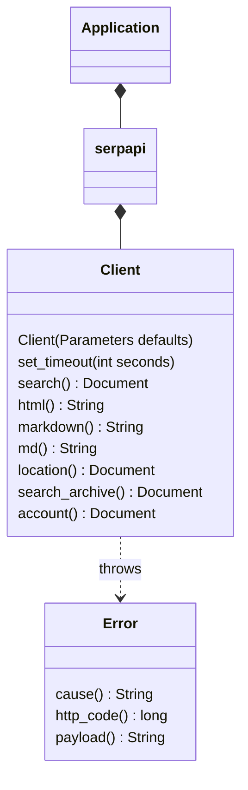

<div align="center">
<h1 align="center">SerpApi C++ Library</h1>

[](https://github.com/serpapi/serpapi-cpp/actions/workflows/ci.yml)
</div>

Integrate search data into your C++ application. This library is the official wrapper for [SerpApi](https://serpapi.com).

SerpApi supports Google, Google Maps, Google Shopping, Baidu, Yandex, Yahoo, eBay, App Stores, and more.

## Installation

C++17, meson and libcurl are required.

```bash
# macOS (Homebrew's curl is keg-only, so point pkg-config at it)
brew install meson curl
export PKG_CONFIG_PATH="$(brew --prefix curl)/lib/pkgconfig:$PKG_CONFIG_PATH"

# Debian/Ubuntu Linux
sudo apt update && sudo apt install -y meson pkg-config libcurl4-openssl-dev
```

RapidJSON does not need to be installed. The build downloads a pinned,
patched copy (see `subprojects/rapidjson.wrap`) and installs its headers
alongside `serpapi.hpp`. The last tagged RapidJSON release, 1.1.0 (2016),
which most package managers ship, is affected by
[CVE-2024-38517](https://nvd.nist.gov/vuln/detail/CVE-2024-38517) and
[CVE-2024-39684](https://nvd.nist.gov/vuln/detail/CVE-2024-39684).

To build against the system RapidJSON instead (e.g. for distribution packaging,
where the package carries its own patches), configure with
`-Dsystem_rapidjson=true`. Your application must then use that same RapidJSON,
because `rapidjson::Document` is part of the serpapi API.

### Installation from Release

Download and extract the latest release:

```bash
curl -sL https://github.com/serpapi/serpapi-cpp/archive/refs/tags/v1.0.0.tar.gz | tar xz
cd serpapi-cpp-1.0.0
meson setup build
meson compile -C build
sudo meson install -C build
```

Tests are disabled by default for release builds. To build and run tests with Meson, install GoogleTest and configure with `-Dtests=true`.

### Meson Dependency

Add the dependency to your `meson.build`:

```meson
serpapi_dep = dependency('serpapi')
```

Or if you are using it as a subproject:

```meson
serpapi_proj = subproject('serpapi')
serpapi_dep = serpapi_proj.get_variable('libserpapi_dep')
```

[SerpApi C++](https://github.com/serpapi/serpapi-cpp)

## Simple Usage

```cpp
#include <iostream>
#include <map>
#include <string>
#include <serpapi.hpp>
#include <rapidjson/document.h>
#include <rapidjson/stringbuffer.h>
#include <rapidjson/prettywriter.h>

int main() {
    const char* env_p = std::getenv("SERPAPI_KEY");
    if (!env_p) return 1;

    std::string apiKey(env_p);
    std::map<std::string, std::string> default_parameter;
    default_parameter["api_key"] = apiKey;
    default_parameter["engine"] = "google";

    serpapi::Client client(default_parameter);

    std::map<std::string, std::string> parameter;
    parameter["q"] = "coffee";
    parameter["location"] = "Austin,TX";

    rapidjson::Document d = client.search(parameter);

    rapidjson::StringBuffer buffer;
    rapidjson::PrettyWriter<rapidjson::StringBuffer> writer(buffer);
    d.Accept(writer);
    std::cout << "\nINFO: " << buffer.GetString() << std::endl;
    return 0;
}
```

This example runs a search for "coffee" on Google. It then returns the results as a RapidJSON Document. See the [playground](https://serpapi.com/playground) to generate your own code, or check out our [local examples](example/).

## Advanced Usage
### Search API
```cpp
#include <serpapi.hpp>

// serpapi client created with default parameters
std::map<std::string, std::string> default_params = {
    {"api_key", "secret_key"},
    {"engine", "google"}
};
serpapi::Client client(default_params);

// search query overview (more fields available depending on search engine)
std::map<std::string, std::string> params = {
  {"engine", "google"},
  {"q", "Coffee"},
  {"location", "Portland,Oregon,United States"},
  {"device", "desktop"},
  {"hl", "en"},
  {"gl", "us"}
};

// formatted search results as a RapidJSON Document
rapidjson::Document results = client.search(params);

// raw search engine html as a String
std::string raw_html = client.html(params);

// raw search engine results as Markdown String
std::string raw_markdown = client.markdown(params);   // or client.md(params)
```

Parameters passed to a call take precedence over the client defaults when the
same key is present in both.

[Google search documentation](https://serpapi.com/search-api).

#### Error handling

All request methods throw `serpapi::Error` (derived from `std::runtime_error`)
whenever SerpApi reports an error, **regardless of the HTTP status code**:

 - an HTTP error status (>= 400), e.g. an invalid `api_key`;
 - an HTTP 200 response that contains an error, e.g. a search with no results
   ("Google hasn't returned any results for this query.");
 - a client-side failure: network error, timeout, or an unparsable JSON body.

If a call returns, the result has no error in it.

```cpp
try {
  rapidjson::Document results = client.search({{"q", "Coffee"}});
} catch (const serpapi::Error &e) {
  std::cerr << e.cause() << std::endl;  // SerpApi's message, e.g. "Invalid API key. ..."
  e.http_code();                          // HTTP status (401, 200, ...), or 0 if no response was received
  e.payload();                           // raw response body, if you need more than the message
}
```

How the error is detected for each output:

| Method | Error detected from |
|--------|---------------------|
| `search()`, `search_archive()`, `account()`, `location()` | a top-level `"error"` member in the JSON response |
| `markdown()` / `md()` | an `## Error` section in the Markdown response |
| `html()` | the HTTP status only. A no-results search returns Google's own page with HTTP 200, which carries no SerpApi error, so it is returned rather than thrown. Use `search()` or `markdown()` to detect it. |

Upgrading from 0.5? See [Migrating from 0.5 to 1.0](MIGRATION.md).

#### Documentation

 * [Full documentation on SerpApi.com](https://serpapi.com)
 * [Library Github page](https://github.com/serpapi/serpapi-cpp)
 * [Google Search example](example/google_example.cpp)
 * [Integration test (OOBT) example](oobt/main.cpp)
 * [API health status](https://serpapi.com/status)

### Location API

```cpp
std::map<std::string, std::string> default_parameter = {};
serpapi::Client client(default_parameter);
std::map<std::string, std::string> parameter;
parameter["limit"] = "3";
parameter["q"] = "Austin";

rapidjson::Document doc = client.location(parameter);
const rapidjson::Value& list = doc.GetArray();

rapidjson::StringBuffer buffer;
rapidjson::PrettyWriter<rapidjson::StringBuffer> writer(buffer);
list.Accept(writer);
std::cout << buffer.GetString() << std::endl;
```

It prints the first 3 locations matching Austin (Texas, Texas, Rochester).

NOTE: api_key is not required for this endpoint.

### Search Archive API

This API allows retrieving previous search results.

```cpp
serpapi::Client client({{"api_key", "secret_api_key"}, {"engine", "google"}});
rapidjson::Document results = client.search({{"q", "Coffee"}, {"location", "Portland"}});
std::string search_id = results["search_metadata"]["id"].GetString();

// Now let's retrieve the previous search results from the archive.
rapidjson::Document archived_results = client.search_archive(search_id);
```

### Account API
```cpp
serpapi::Client client({{"api_key", "secret_api_key"}});
rapidjson::Document account_info = client.account();
```

## Advanced search API usage

Search API features non-blocking search using the option: `async=true`.
 - Non-blocking - async=true - a single parent process can handle unlimited concurrent searches.
 - Blocking - async=false - processes must wait for the HTTP response.

### Example: Asynchronous searches

```cpp
#include <serpapi.hpp>
#include <rapidjson/document.h>
#include <iostream>

int main() {
    serpapi::Client client({{"api_key", "YOUR_API_KEY"}, {"engine", "google"}});

    std::map<std::string, std::string> parameter;
    parameter["q"] = "coffee";
    parameter["async"] = "true";

    rapidjson::Document d = client.search(parameter);
    std::string id = d["search_metadata"]["id"].GetString();

    // You can later retrieve the results using search_archive
    rapidjson::Document results = client.search_archive(id);
    return 0;
}
```

## Supported C++ version.
C++ versions validated by Github Actions:
 - C++17
 - C++20

To build with another standard locally: `CPP_STD=c++20 rake coverage`.

## Change logs
 * [2026-10-05] 1.0.0 First stable release: the public API and ABI are stable for all 1.x releases. Throw `serpapi::Error` whenever the response contains an error, independent of the HTTP status; call parameters override client defaults; public header no longer depends on libcurl; bundle a CVE-patched RapidJSON (CVE-2024-38517, CVE-2024-39684); snake_case API (`set_timeout()`, `http_code()`); versioned shared library (`soversion` 1); add `md()` alias; C++17 and C++20 tested in CI. **Breaking:** see [Migrating from 0.5 to 1.0](MIGRATION.md).
 * [2026-08-16] 0.5.0 Add markdown() support via the output=md format.
 * [2026-06-26] 0.4.1 Exclude test dependencies from release build.
 * [2026-06-08] 0.4.0 Add unit tests and improve error handling.
 * [2026-02-12] 0.3.0 Refactor and cleanup.
 * [2026-01-06] 0.2.0 Release package with meson build system.
 * [2023-02-20] 0.1.0 Full API support

## Developer Guide
### Key goals
 - Brand centric instead of search engine based
 - Simple HTTP client (lightweight, reduced dependency)
 - Easy extension
 - Defensive code style
 - TDD
 - KiSS principles

### Code quality expectations
 - 0 lint offense: `rake lint`
 - 100% tests passing: `rake test`
 - 100% code coverage: `rake coverage`

### Code coverage

Coverage is collected with gcov and reported with [gcovr](https://gcovr.com).
CI runs `rake coverage` on every push and pull request.

```bash
export SERPAPI_KEY="your_secret_key"   # optional; without it, live-API tests are skipped and coverage drops to ~94%
rake coverage
```

`rake coverage` reconfigures `build/` with `-Db_coverage=true -Dtests=true`
(wiping any previous configuration), runs the test suite, and prints the
report. To browse line-by-line coverage in HTML afterwards:

```bash
gcovr -r . --filter src/ --html-details -o build/coverage.html
open build/coverage.html   # macOS; use xdg-open on Linux
```

Example output:

```text
------------------------------------------------------------------------------
                           GCC Code Coverage Report
Directory: .
------------------------------------------------------------------------------
File                                       Lines    Exec  Cover   Missing
------------------------------------------------------------------------------
src/callback.cpp                              11       8    72%   15-17
src/query.cpp                                 29      29   100%
src/response.cpp                              45      45   100%
src/serpapi.cpp                               86      83    96%   41,117-118
src/serpapi.hpp                                1       1   100%
------------------------------------------------------------------------------
TOTAL                                        172     166    96%
------------------------------------------------------------------------------
lines: 96.5% (166 out of 172)
functions: 100.0% (43 out of 43)
branches: 61.1% (184 out of 301)
```

### Latest coverage report

Generated on 2026-10-05 with `rake coverage` (Apple clang 21, gcovr 8.4, C++17, `SERPAPI_KEY` set):

| File              | Lines | Exec | Cover |
|-------------------|------:|-----:|------:|
| src/callback.cpp  |    11 |    8 |   72% |
| src/query.cpp     |    29 |   29 |  100% |
| src/response.cpp  |    45 |   45 |  100% |
| src/serpapi.cpp   |    86 |   83 |   96% |
| src/serpapi.hpp   |     1 |    1 |  100% |
| **TOTAL**         | **172** | **166** | **96%** |

 - lines: 96.5% (166/172), up from 78.0% in 0.5.0
 - functions: 100.0% (43/43)
 - branches: 61.1% (184/301)

The remaining uncovered lines need fault injection to reach:

| Location | Path | Why it is not covered |
|----------|------|-----------------------|
| `callback.cpp:15-17` | `std::string::append` throws `bad_alloc` | Requires memory exhaustion. |
| `serpapi.cpp:41` | `curl_easy_init()` returns null | Requires libcurl to fail allocating a handle. |
| `serpapi.cpp:117-118` | 2xx response whose body is not valid JSON | SerpApi always returns JSON for `output=json`. |

## Design : UML diagram
### Class diagram


## Continuous integration
We use GitHub Actions for continuous integration.

Set your secret API key in your shell before running tests.
```bash
export SERPAPI_KEY="your_secret_key"
```

Check code quality using Lint.
```bash
rake lint
```

Run tests.
```bash
rake test
```

## Run with Docker

Runs the full check (`rake`) in Ubuntu 24.04, the same image as CI. The
sources are mounted read-only and copied, so the container does not touch
your local `build/` directory.

```bash
docker run --rm -it -e SERPAPI_KEY -v "$PWD":/src:ro ubuntu:24.04 bash -c '
  export DEBIAN_FRONTEND=noninteractive &&
  apt-get update && apt-get install -y sudo ruby rake &&
  cp -r /src /work && cd /work &&
  rake install:linux default'
```

## Development
 - Set an environment SERPAPI_KEY=<secret>
 - Install dependencies:
    - `rake install:apple`
    - `rake install:linux`
 - Initialize the project: `rake setup`
 - Build: `rake build`
 - Run examples: `rake example`
 - Generate API documentation into `docs/` (requires Doxygen): `rake doc`
 - Full check before a release (clean build, tests with coverage, lint, examples): `rake`

## References
- https://formulae.brew.sh/formula/googletest
- https://rapidjson.org/md_doc_tutorial.html

