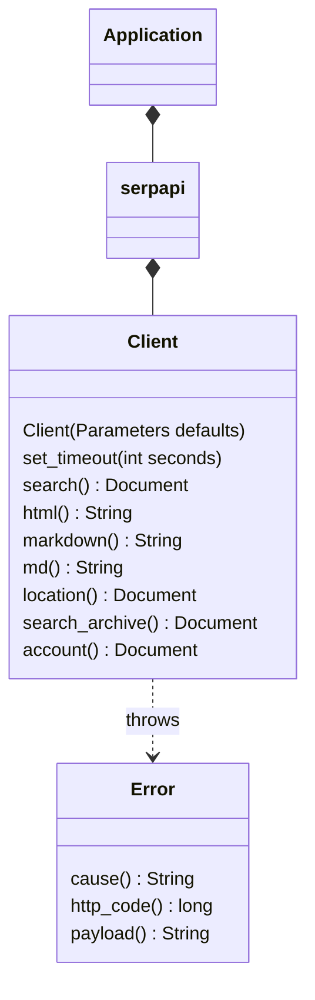

# SerpApi C++ Library

[](https://github.com/serpapi/serpapi-cpp/actions/workflows/ci.yml)

Integrate search data into your C++ application. This library is the official wrapper for [SerpApi](https://serpapi.com).

SerpApi supports Google, Google Maps, Google Shopping, Baidu, Yandex, Yahoo, eBay, App Stores, and more.

## Installation

C++17, meson and libcurl are required.

```bash
# macOS (Homebrew's curl is keg-only, so point pkg-config at it)
brew install meson pkg-config curl
export PKG_CONFIG_PATH="$(brew --prefix curl)/lib/pkgconfig:$PKG_CONFIG_PATH"

# Debian/Ubuntu Linux
sudo apt update && sudo apt install -y meson pkg-config libcurl4-openssl-dev
```

RapidJSON does not need to be installed. The build downloads a pinned,
patched copy (see `subprojects/rapidjson.wrap`) and installs its headers
alongside `serpapi.hpp`. The last tagged RapidJSON release, 1.1.0 (2016),
which most package managers ship, is affected by
[CVE-2024-38517](https://nvd.nist.gov/vuln/detail/CVE-2024-38517) and
[CVE-2024-39684](https://nvd.nist.gov/vuln/detail/CVE-2024-39684).

To build against the system RapidJSON instead (e.g. for distribution packaging,
where the package carries its own patches), configure with
`-Dsystem_rapidjson=true`. Your application must then use that same RapidJSON,
because `rapidjson::Document` is part of the serpapi API.

If compiling your application fails with *"serpapi.hpp sees different
RapidJSON headers than libserpapi was built with"*, another RapidJSON (for
example a system 1.1.0) comes first on your include path. Put serpapi's include
directory first, as `pkg-config --cflags serpapi` does, and include
`<serpapi.hpp>` before any other RapidJSON header. Without this check, such a
program would compile and then crash at run time.

### Installation

Download and extract the latest release:

```bash
curl -sL https://github.com/serpapi/serpapi-cpp/archive/refs/tags/v1.0.0.tar.gz | tar xz
cd serpapi-cpp-1.0.0
meson setup build
meson compile -C build
sudo meson install -C build
```

Tests are not built by default. To build and run them, install GoogleTest and configure with `-Dtests=true`.

### Meson dependency

Add the dependency to your `meson.build`. With `fallback`, Meson uses an
installed serpapi if pkg-config finds one, and otherwise builds it from
`subprojects/serpapi` (for example a git clone or a wrap file):

```meson
serpapi_dep = dependency('serpapi', fallback : ['serpapi', 'libserpapi_dep'])
```

[SerpApi C++](https://github.com/serpapi/serpapi-cpp)

## Quick start

```cpp
#include <cstdlib>
#include <iostream>
#include <serpapi.hpp>

int main() {
  const char *api_key = std::getenv("SERPAPI_KEY");
  if (api_key == nullptr) {
    std::cerr << "Set SERPAPI_KEY to your SerpApi API key" << std::endl;
    return 1;
  }

  serpapi::Client client({{"api_key", api_key}, {"engine", "google"}});

  try {
    rapidjson::Document results = client.search({{"q", "coffee"}, {"location", "Austin,TX"}});

    if (results.HasMember("organic_results")) {
      for (const auto &result : results["organic_results"].GetArray()) {
        if (result.HasMember("title")) std::cout << result["title"].GetString() << std::endl;
      }
    }
  } catch (const serpapi::Error &e) {
    std::cerr << "Search failed: " << e.cause() << std::endl;
    return 1;
  }
  return 0;
}
```

This example runs a Google search for "coffee" near Austin, TX and prints the
title of each organic result. Results come back as a RapidJSON `Document`, and
any error throws `serpapi::Error` (see [Error handling](#error-handling)). See
the [playground](https://serpapi.com/playground) to generate your own code, or
the [examples](#examples).

## Advanced usage
### Search API
```cpp
#include <serpapi.hpp>

// serpapi client created with default parameters, sent with every request
serpapi::Client client({{"api_key", "secret_key"}, {"engine", "google"}});

// search query overview (more fields available depending on search engine)
serpapi::Parameters params = {
  {"q", "Coffee"},
  {"location", "Portland,Oregon,United States"},
  {"device", "desktop"},
  {"hl", "en"},
  {"gl", "us"}
};

// formatted search results as a RapidJSON Document
rapidjson::Document results = client.search(params);

// raw search engine html as a String
std::string raw_html = client.html(params);

// raw search engine results as Markdown String
std::string raw_markdown = client.markdown(params);   // or client.md(params)

// a per-call parameter overrides the client default for that call only
rapidjson::Document bing = client.search({{"engine", "bing"}, {"q", "Coffee"}});
```

Parameters passed to a call take precedence over the client defaults when the
same key is present in both. `serpapi::Parameters` is a
`std::map<std::string, std::string>`.

[Google search documentation](https://serpapi.com/search-api).

#### Client options

 - `client.set_timeout(30)` sets the timeout of each request in seconds (default 60).
 - Request methods are `const` and can be called concurrently from several
   threads on the same `Client`. `set_timeout()` is not synchronized: call it
   before sharing the client between threads.
 - `Client` is copyable and movable. Copies are independent, so each copy can
   have its own defaults and timeout.

#### Error handling

All request methods throw `serpapi::Error` (derived from `std::runtime_error`)
whenever SerpApi reports an error, **regardless of the HTTP status code**:

 - an HTTP error status (>= 400), e.g. an invalid `api_key`;
 - an HTTP 200 response that contains an error, e.g. a search with no results
   ("Google hasn't returned any results for this query.");
 - a client-side failure: network error, timeout, or an unparsable JSON body.

If a call returns, the result has no error in it.

```cpp
try {
  rapidjson::Document results = client.search({{"q", "Coffee"}});
} catch (const serpapi::Error &e) {
  std::cerr << e.cause() << std::endl;  // SerpApi's message, e.g. "Invalid API key. ..."
  e.http_code();                          // HTTP status (401, 200, ...), or 0 if no response was received
  e.payload();                           // raw response body, if you need more than the message
}
```

How the error is detected for each output:

| Method | Error detected from |
|--------|---------------------|
| `search()`, `search_archive()`, `account()`, `location()` | a top-level `"error"` member in the JSON response |
| `markdown()` / `md()` | an `## Error` section in the Markdown response |
| `html()` | the HTTP status only. A no-results search returns Google's own page with HTTP 200, which carries no SerpApi error, so it is returned rather than thrown. Use `search()` or `markdown()` to detect it. |

Upgrading from 0.5? See [Migrating from 0.5 to 1.0](MIGRATION.md).

#### Documentation

 * [Full documentation on SerpApi.com](https://serpapi.com)
 * [Library Github page](https://github.com/serpapi/serpapi-cpp)
 * [Examples](#examples): one program per API endpoint and per search engine
 * [Demo program](demo/main.cpp)
 * [API health status](https://serpapi.com/status)

### Location API

```cpp
std::map<std::string, std::string> default_parameter = {};
serpapi::Client client(default_parameter);
std::map<std::string, std::string> parameter;
parameter["limit"] = "3";
parameter["q"] = "Austin";

rapidjson::Document doc = client.location(parameter);
const rapidjson::Value& list = doc.GetArray();

rapidjson::StringBuffer buffer;
rapidjson::PrettyWriter<rapidjson::StringBuffer> writer(buffer);
list.Accept(writer);
std::cout << buffer.GetString() << std::endl;
```

It prints the first 3 locations matching Austin: Austin, Texas; Austin,
Minnesota; and Austin, Indiana (all in the United States).

NOTE: api_key is not required for this endpoint.

### Search Archive API

This API allows retrieving previous search results.

```cpp
serpapi::Client client({{"api_key", "secret_api_key"}, {"engine", "google"}});
rapidjson::Document results = client.search({{"q", "Coffee"}, {"location", "Portland"}});
std::string search_id = results["search_metadata"]["id"].GetString();

// Now let's retrieve the previous search results from the archive.
rapidjson::Document archived_results = client.search_archive(search_id);
```

### Account API
```cpp
serpapi::Client client({{"api_key", "secret_api_key"}});
rapidjson::Document account_info = client.account();
```

### Pagination

Google pages are selected with the `start` offset: `0` for the first page,
then `10`, `20`, and so on. The offset advances by 10 even when a page shows
fewer organic results. The response's `serpapi_pagination.next` is present
only while there is a next page, so stop when it is missing. Requesting
past the last page uses a search credit and can fail with an error.

```cpp
serpapi::Client client({{"api_key", "secret_api_key"}, {"engine", "google"}});

for (int start = 0; start < 30; start += 10) {  // at most 3 pages
  rapidjson::Document page = client.search({{"q", "coffee"}, {"start", std::to_string(start)}});

  if (page.HasMember("organic_results")) {
    for (const auto &result : page["organic_results"].GetArray()) {
      if (result.HasMember("title")) std::cout << result["title"].GetString() << std::endl;
    }
  }

  if (!page.HasMember("serpapi_pagination") || !page["serpapi_pagination"].HasMember("next")) {
    break;  // last page
  }
}
```

Each page is a separate search and uses one search credit. Other engines page
with different parameters (for example `first` for Bing, `page` or a page
token for others). The `serpapi_pagination.next` URL of each response shows
the parameters for the next page. The
[Google Search example](example/google_example.cpp) is a complete program
that combines search, search archive and pagination, with error handling.

### Asynchronous searches

By default `search()` waits until the results are ready. With `async=true`,
SerpApi accepts the search and returns at once with its id and a `Queued` or
`Processing` status, so a single thread can submit many searches before
collecting any results. Retrieve each search from the archive until its status
is no longer `Queued` or `Processing`. Archive lookups are free; the search
itself uses one credit.

```cpp
#include <chrono>
#include <thread>

serpapi::Client client({{"api_key", "secret_api_key"}, {"engine", "google"}});

rapidjson::Document submitted = client.search({{"q", "coffee"}, {"async", "true"}});
const std::string id = submitted["search_metadata"]["id"].GetString();

rapidjson::Document results;
for (int attempt = 0; attempt < 60; ++attempt) {  // give up after about a minute
  results = client.search_archive(id);
  const std::string status = results["search_metadata"]["status"].GetString();
  if (status != "Queued" && status != "Processing") break;  // "Success"
  std::this_thread::sleep_for(std::chrono::seconds(1));
}
```

If the search fails, `search_archive()` throws `serpapi::Error` like any other
call. If the status is still `Queued` or `Processing` after the loop, the
search has not finished yet; retrieve it again later with the same id. Do not
combine `async` with `no_cache`, and do not use `async` on accounts with
[Ludicrous Speed](https://serpapi.com/plan) enabled.

## Examples

Complete, runnable programs live in [example/](example/). Each reads the API
key from `SERPAPI_KEY` and skips if it is not set.

```bash
export SERPAPI_KEY="your_secret_key"
rake setup build
rake example                  # run all examples
rake example[bing_example]    # run one example
```

Every search uses one search credit; location, account and search archive
lookups are free. Running all examples uses about 17 searches, so the full
`rake` check runs only `google_example`.

### API endpoints

| Example | Method | Credits |
|---------|--------|--------:|
| [google_example](example/google_example.cpp) | `search()`, `search_archive()` and pagination combined | 3 |
| [search_example](example/search_example.cpp) | `search()`: results as JSON | 1 |
| [html_example](example/html_example.cpp) | `html()`: raw HTML page | 1 |
| [markdown_example](example/markdown_example.cpp) | `markdown()`: page as Markdown | 1 |
| [location_example](example/location_example.cpp) | `location()`: no `api_key` needed | 0 |
| [search_archive_example](example/search_archive_example.cpp) | `search_archive()`: pass a search id as argument to skip the search | 0–1 |
| [account_example](example/account_example.cpp) | `account()`: plan and usage | 0 |

### Search engines

The same engines and parameters as the
[Ruby client's examples](https://github.com/serpapi/serpapi-ruby/tree/master/spec/serpapi/client/example).

| Example | Engine | Parameters | Results |
|---------|--------|------------|---------|
| [baidu_example](example/baidu_example.cpp) | [Baidu](https://serpapi.com/baidu-search-api) | `q` | `organic_results` |
| [bing_example](example/bing_example.cpp) | [Bing](https://serpapi.com/bing-search-api) | `q` | `organic_results` |
| [duckduckgo_example](example/duckduckgo_example.cpp) | [DuckDuckGo](https://serpapi.com/duckduckgo-search-api) | `q` | `organic_results` |
| [ebay_example](example/ebay_example.cpp) | [eBay](https://serpapi.com/ebay-search-api) | `_nkw` | `organic_results` |
| [google_maps_example](example/google_maps_example.cpp) | [Google Maps](https://serpapi.com/google-maps-api) | `q`, `ll`, `type` | `local_results` |
| [naver_example](example/naver_example.cpp) | [Naver](https://serpapi.com/naver-search-api) | `query` | `ads_results` |
| [walmart_example](example/walmart_example.cpp) | [Walmart](https://serpapi.com/walmart-search-api) | `query` | `organic_results` |
| [yahoo_example](example/yahoo_example.cpp) | [Yahoo](https://serpapi.com/yahoo-search-api) | `p` | `organic_results` |
| [yandex_example](example/yandex_example.cpp) | [Yandex](https://serpapi.com/yandex-search-api) | `text` | `organic_results` |
| [youtube_example](example/youtube_example.cpp) | [YouTube](https://serpapi.com/youtube-search-api) | `search_query` | `video_results` |

Each engine names its query parameter differently (`q`, `p`, `text`, `query`,
`_nkw`, `search_query`); see the engine's documentation for the full list.

## Supported C++ versions
C++ versions and platforms validated by GitHub Actions:
 - C++17 on Ubuntu (gcc) and macOS (Apple clang)
 - C++20 on Ubuntu (gcc)

To build with another standard locally: `CPP_STD=c++20 rake coverage`.

## Changelog
 * [2026-10-05] 1.0.0 First stable release: the public API and ABI are stable for all 1.x releases. Throw `serpapi::Error` whenever the response contains an error, independent of the HTTP status; call parameters override client defaults; public header no longer depends on libcurl; bundle a CVE-patched RapidJSON (CVE-2024-38517, CVE-2024-39684); snake_case API (`set_timeout()`, `http_code()`); versioned shared library (`soversion` 1) that exports only `Client` and `Error`; connects over IPv6 when available (was IPv4 only); compile-time check that applications use the same RapidJSON as the library; add `md()` alias; C++17 and C++20 tested in CI. **Breaking:** see [Migrating from 0.5 to 1.0](MIGRATION.md).
 * [2026-08-16] 0.5.0 Add markdown() support via the output=md format.
 * [2026-06-26] 0.4.1 Exclude test dependencies from release build.
 * [2026-06-08] 0.4.0 Add unit tests and improve error handling.
 * [2026-02-12] 0.3.0 Refactor and cleanup.
 * [2026-01-06] 0.2.0 Release package with meson build system.
 * [2023-02-20] 0.1.0 Full API support

## Developer guide
### Key goals
 - Brand centric instead of search engine based
 - Simple HTTP client (lightweight, reduced dependency)
 - Easy extension
 - Defensive code style
 - TDD
 - KiSS principles

### Code quality expectations
 - 0 lint offense: `rake lint`
 - 100% tests passing: `rake test`
 - 100% of reachable lines covered: `rake coverage` (lines that need fault injection are listed in [Latest coverage report](#latest-coverage-report))

### Code coverage

Coverage is collected with gcov and reported with [gcovr](https://gcovr.com).
CI runs `rake coverage` on every push and pull request.

```bash
export SERPAPI_KEY="your_secret_key"   # optional; without it, live-API tests are skipped and coverage drops to ~94%
rake coverage
```

`rake coverage` reconfigures `build/` with `-Db_coverage=true -Dtests=true`
(wiping any previous configuration), runs the test suite, and prints the
report. To browse line-by-line coverage in HTML afterwards:

```bash
gcovr -r . --filter src/ --html-details -o build/coverage.html
open build/coverage.html   # macOS; use xdg-open on Linux
```

Example output:

```text
------------------------------------------------------------------------------
                           GCC Code Coverage Report
Directory: .
------------------------------------------------------------------------------
File                                       Lines    Exec  Cover   Missing
------------------------------------------------------------------------------
src/callback.cpp                              11       8    72%   15-17
src/query.cpp                                 29      29   100%
src/response.cpp                              45      45   100%
src/serpapi.cpp                               86      83    96%   41,117-118
src/serpapi.hpp                                1       1   100%
------------------------------------------------------------------------------
TOTAL                                        172     166    96%
------------------------------------------------------------------------------
lines: 96.5% (166 out of 172)
functions: 100.0% (43 out of 43)
branches: 61.1% (184 out of 301)
```

### Latest coverage report

Generated on 2026-10-05 with `rake coverage` (Apple clang 21, gcovr 8.4, C++17, `SERPAPI_KEY` set):

| File              | Lines | Exec | Cover |
|-------------------|------:|-----:|------:|
| src/callback.cpp  |    11 |    8 |   72% |
| src/query.cpp     |    29 |   29 |  100% |
| src/response.cpp  |    45 |   45 |  100% |
| src/serpapi.cpp   |    86 |   83 |   96% |
| src/serpapi.hpp   |     1 |    1 |  100% |
| **TOTAL**         | **172** | **166** | **96%** |

 - lines: 96.5% (166/172), up from 78.0% in 0.5.0
 - functions: 100.0% (43/43)
 - branches: 61.1% (184/301)

The remaining uncovered lines need fault injection to reach:

| Location | Path | Why it is not covered |
|----------|------|-----------------------|
| `callback.cpp:15-17` | `std::string::append` throws `bad_alloc` | Requires memory exhaustion. |
| `serpapi.cpp:41` | `curl_easy_init()` returns null | Requires libcurl to fail allocating a handle. |
| `serpapi.cpp:118-119` | 2xx response whose body is not valid JSON | SerpApi always returns JSON for `output=json`. |

## Design: UML diagram
### Class diagram


## Continuous integration

GitHub Actions ([ci.yml](.github/workflows/ci.yml)) runs on every push and
pull request to `main`, in three jobs: Ubuntu with C++17, Ubuntu with C++20,
and macOS (Apple silicon) with C++17. Each job installs the dependencies
(`rake install:linux` or `rake install:apple`) and runs `rake coverage`. The
Ubuntu C++17 job also runs `rake lint` and is the only one given the
repository secret `SERPAPI_KEY`, so the live-API tests run, and use the API,
once per CI run.

Run the same checks locally:

```bash
export SERPAPI_KEY="your_secret_key"   # optional; live-API tests are skipped without it
rake setup                              # configure build/ with tests enabled (once)
rake test
rake lint
```

## Run with Docker

Runs the full check (`rake`) in Ubuntu 24.04, the same image as CI. The
sources are mounted read-only and copied, so the container does not touch
your local `build/` directory.

```bash
docker run --rm -it -e SERPAPI_KEY -v "$PWD":/src:ro ubuntu:24.04 bash -c '
  export DEBIAN_FRONTEND=noninteractive &&
  apt-get update && apt-get install -y sudo ruby rake &&
  cp -r /src /work && cd /work &&
  rake install:linux default'
```

## Development
 - Set an environment SERPAPI_KEY=<secret>
 - Install dependencies:
    - `rake install:apple`
    - `rake install:linux`
 - Initialize the project: `rake setup`
 - Build: `rake build`
 - Run examples: `rake example` (all) or `rake example[bing_example]` (one); see [Examples](#examples)
 - Generate API documentation into `docs/` (requires Doxygen): `rake doc`
 - Full check before a release (clean build, tests with coverage, lint, `google_example`, demo): `rake`

## References
- https://formulae.brew.sh/formula/googletest
- https://rapidjson.org/md_doc_tutorial.html

